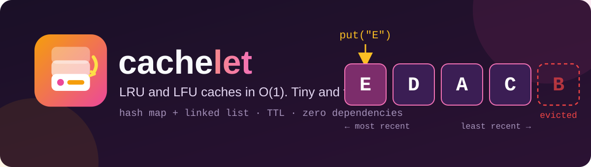
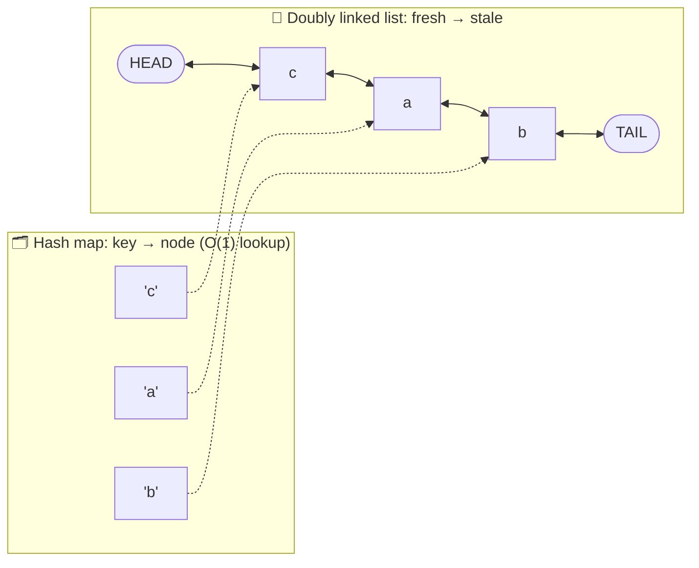
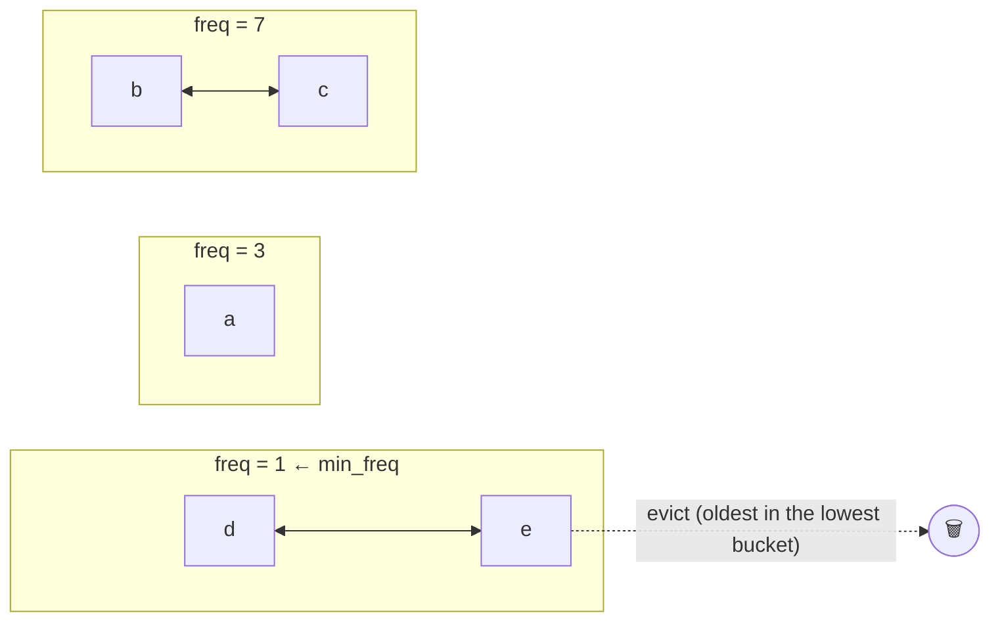

<div align="center">



<br/>

[](https://github.com/YOUR_USERNAME/cachelet/actions)
[](https://www.python.org/)
[](pyproject.toml)
[-8B5CF6?style=for-the-badge)](#-how-it-works)
[](LICENSE)
[](https://github.com/YOUR_USERNAME/cachelet/stargazers)

### 🧠 A cache that knows what to forget.

**Small, readable LRU and LFU caches where every operation is O(1), with TTL expiry, hit/miss stats, eviction callbacks, thread safety and a memoization decorator. Zero dependencies.**

[✨ Features](#-features) •
[🚀 Quick start](#-quick-start) •
[🧠 How it works](#-how-it-works) •
[📖 API](#-api) •
[📊 Benchmarks](#-benchmarks) •
[⚖️ LRU or LFU?](#%EF%B8%8F-lru-or-lfu) •
[🗺️ Roadmap](#%EF%B8%8F-roadmap)

</div>

---

## ✨ Features

| | Feature | Details |
|:--:|---|---|
| ⚡ | **True O(1)** | `get`, `put`, `delete` and eviction never scan the cache, for both LRU **and** LFU |
| 🕰️ | **LRU and LFU** | Two policies behind one identical API |
| ⏳ | **TTL expiry** | Entries expire on their own, with an injectable clock for testing |
| 📊 | **Built-in stats** | Hits, misses, evictions, expirations and hit rate |
| 🔔 | **Eviction callback** | `on_evict(key, value)` to flush, log or clean up |
| 🧵 | **Thread-safe mode** | Opt in with `thread_safe=True` |
| 🎀 | **`@cached` decorator** | Memoize any function with either policy and a TTL |
| 🐍 | **Feels like a dict** | `cache[k] = v`, `k in cache`, `len(cache)`, `del cache[k]` |
| ✅ | **Properly tested** | Randomized tests compare both caches against simple reference models |
| 🪶 | **Tiny** | Pure standard library, small enough to read in one sitting |

---

## 🚀 Quick start

```bash
git clone https://github.com/YOUR_USERNAME/cachelet.git
cd cachelet
pip install -e .
```

```python
from cachelet import LRUCache, LFUCache, cached

# LRU: forgets what you haven't touched lately
cache = LRUCache(capacity=3)
cache.put("a", 1); cache.put("b", 2); cache.put("c", 3)
cache.get("a")            # "a" is now the freshest
cache.put("d", 4)         # full, so "b" (least recently used) is evicted
cache.keys()              # ['d', 'a', 'c']   fresh -> stale

# LFU: forgets what you rarely use
hot = LFUCache(capacity=2)
hot.put("x", 1); hot.put("y", 2)
hot.get("x"); hot.get("x")
hot.put("z", 3)           # "y" was used the fewest times, so it goes

# TTL + stats + callback
sessions = LRUCache(1000, ttl=300, on_evict=lambda k, v: print("evicted", k))
sessions.put("token", "abc")
sessions.stats.hit_rate   # 0.0 ... 1.0

# Memoize a function
@cached(maxsize=256, ttl=60, policy="lfu")
def load_user(user_id):
    ...                   # slow work here

load_user(7); load_user(7)        # second call is instant
load_user.cache_info()            # CacheStats(hits=1, misses=1, ...)
load_user.cache_clear()
```

Run the full demo: `python examples/demo.py`

---

## 🧠 How it works

> **Plain-English version:** a hash map finds anything instantly but has no sense of order. A linked list has a perfect sense of order but finding things is slow. **Glue them together** and you get both.

### LRU: hash map + doubly linked list



| Operation | What happens | Cost |
|---|---|---|
| `get(k)` | Map finds the node, then it is unplugged and re-plugged at the **front** | O(1) |
| `put(k, v)` (new) | Add a node at the front. If full, drop the node at the **back** (and its map entry) | O(1) |
| evict | The least recently used entry is always `TAIL.prev`, so no searching | O(1) |

Because the list is *doubly* linked and has sentinel `HEAD`/`TAIL` nodes, removing a node needs no loop and no special cases for the ends.

### LFU: one list per use-count



Each use moves a node from bucket `f` to bucket `f + 1`, and a single `min_freq` pointer says where to evict from. That keeps LFU at O(1) too, instead of the usual "scan or heap" at O(n) / O(log n). Ties are broken by recency.

### Complexity

| Operation | LRU | LFU |
|---|:--:|:--:|
| `get`, `put`, `delete`, `pop` | O(1) | O(1) |
| `peek`, `in` | O(1) | O(1) |
| eviction | O(1) | O(1) |
| `keys`, `items`, `purge` | O(n) | O(n log f) |
| Space | O(capacity) | O(capacity) |

*(`f` = number of distinct frequencies. Averages assume hashable keys with normal hashing.)*

---

## 📖 API

Both `LRUCache` and `LFUCache` take the same arguments and expose the same methods.

```python
LRUCache(capacity, *, ttl=None, on_evict=None, thread_safe=False, timer=time.monotonic)
```

| Method | What it does |
|---|---|
| `get(key, default=None)` | Read a value. Counts as a **use** and as a hit or miss |
| `put(key, value)` | Insert or update. Evicts one entry first when full |
| `peek(key, default=None)` | Read **without** counting as a use, so no reorder and no stats |
| `delete(key) -> bool` | Remove a key |
| `pop(key[, default])` | Remove and return a value (`KeyError` if absent and no default) |
| `purge() -> int` | Remove all expired entries now |
| `clear()` | Remove everything |
| `keys()`, `items()` | Fresh → stale (LRU), or most used → least used (LFU) |
| `stats` | `CacheStats(hits, misses, evictions, expirations, size, capacity)` plus `.hit_rate` |
| `reset_stats()` | Zero the counters |
| `cache[k]`, `cache[k] = v`, `del cache[k]`, `k in cache`, `len(cache)` | Dict-style sugar |
| `LFUCache.frequency(key)` | Use-count of a key (LFU only) |

**Good to know**

- `None` is a perfectly valid value. Use `in` or `peek` if you need to tell "missing" from `None`.
- `on_evict` fires for **capacity** evictions only, not for deletes or expirations.
- Expired entries are removed lazily when touched (or on `purge()`), so `len()` may briefly include them.
- `@cached` keys are built from the call arguments, which must be hashable.

---

## 📊 Benchmarks

Run it yourself with `python benchmarks/bench.py`. Numbers below are from one run on CPython 3.12 and will vary by machine.

### Speed: why O(1) matters

Million operations per second (higher is better), as the cache grows:

| Capacity | "Obvious" list-based LRU | `OrderedDict` LRU | **cachelet LRU** |
|--:|--:|--:|--:|
| 100 | 2.88 | 5.61 | **1.05** |
| 1,000 | 0.50 | 4.53 | **0.97** |
| 5,000 | 0.13 | 4.44 | **0.95** |

- The list-based version gets **~22x slower** as capacity grows from 100 to 5,000, because every access scans the list. **cachelet stays flat**, which is what O(1) means.
- An `OrderedDict`-based LRU is faster in raw speed because `OrderedDict` is implemented in C. cachelet is pure Python, and it trades some speed for LFU, TTL, stats and callbacks, plus code you can read and learn from.
- Python's own `functools.lru_cache` is also C-accelerated and is the right pick if all you need is plain function memoization.

### Quality: when LFU beats LRU

A skewed workload (a few popular keys, plus occasional one-off scans over 300 never-repeated keys), capacity 100, 200,000 requests:

| Policy | Hit rate |
|---|--:|
| LRU | 45.2% |
| **LFU** | **51.6%** |

Scans flush an LRU cache of its popular entries, while LFU remembers who is actually popular.

---

## ⚖️ LRU or LFU?

| Choose | When |
|---|---|
| **LRU** | Recent use predicts future use: web sessions, recently opened files, UI state, general-purpose caching |
| **LFU** | A stable set of popular items with occasional bursts or scans: popular products, hot config, DNS-style lookups |

Not sure? Start with LRU, check `cache.stats.hit_rate`, and swap to `LFUCache` (same API) to compare on your real traffic.

---

## 🗂️ Project structure

```text
cachelet/
├── 📁 cachelet/
│   ├── __init__.py
│   ├── _dlist.py        # doubly linked list with sentinels
│   ├── base.py          # hash map, TTL, stats, locking, eviction flow
│   ├── lru.py           # LRU policy
│   ├── lfu.py           # LFU policy (frequency buckets)
│   └── decorator.py     # @cached
├── 📁 tests/            # unit, model-based and thread tests
├── 📁 examples/         # demo.py
├── 📁 benchmarks/       # bench.py
├── 📁 assets/           # logo and banner (SVG)
├── 📁 .github/workflows # CI on Python 3.9 – 3.12
├── pyproject.toml
├── LICENSE
└── README.md
```

A policy only answers four questions (`_insert`, `_touch`, `_unlink`, `_victim`), so adding **FIFO**, **MRU** or **ARC** means writing one small class.

Run the tests:

```bash
pip install -e ".[dev]"
pytest -q
```

---

## 🗺️ Roadmap

- [x] LRU and LFU with O(1) operations
- [x] TTL, stats, callbacks, thread-safe mode
- [x] `@cached` decorator
- [ ] FIFO and MRU policies
- [ ] Async-friendly decorator
- [ ] Per-entry TTL override in `put(..., ttl=...)`
- [ ] Optional size-based capacity (bytes instead of entries)
- [ ] Publish to PyPI

Have an idea? [Open an issue](https://github.com/YOUR_USERNAME/cachelet/issues).

---

## 🤝 Contributing

Beginner-friendly PRs are welcome.

1. Fork the repo and create a branch: `git checkout -b feature/my-idea`
2. Add tests and run `pytest`
3. Open a pull request

---

## 📜 License

Released under the [MIT License](LICENSE).

<div align="center">

<br/>

**If this made linked lists and hash maps finally click, please give it a ⭐**

<sub>Built with 🧡 while learning Data Structures and Algorithms.</sub>

</div>
